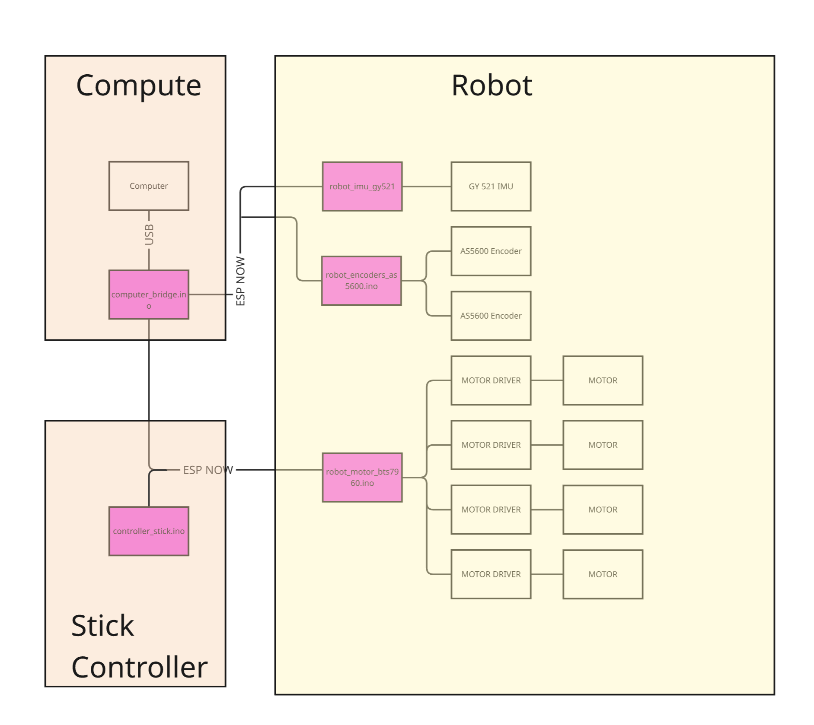

# eLlama

A suitcase-sized, four-wheel-drive outdoor robot base built on the ESP32. Drive it with the handheld controller out of the box, or send it left/right speeds from any computer. You bring the battery and, if you want one, the computer.

Demo video: **[youtu.be/O5k8u-hmhis](https://youtu.be/O5k8u-hmhis)**. Try the 3D drive simulator in your browser: **[huggingface.co/spaces/r5d2/ellama-simulator](https://huggingface.co/spaces/r5d2/ellama-simulator)**.

## What it is

- **Four-wheel drive, suitcase size.** 17 in track, 16 in wheelbase, 10 in pneumatic wheels, about 32 lb without a battery. One person can lift it into a car.
- **Manual or computer control, same robot.** The chassis takes two numbers, a left speed and a right speed. The stick controller sends them, or a computer does through a USB bridge. No firmware change between the two.
- **ESP32 throughout.** Motor board, sensors, controller and bridge are all ESP32s talking ESP-NOW. Plain Arduino sketches, no libraries beyond `esp_now.h`.
- **Wheel encoders and an IMU.** AS5600 magnetic encoders on two wheels and an MPU-6050 or ICM-20948 IMU, streamed back to the computer.
- **Bring your own battery.** 12 V SLA, 12 V LiFePO4 or an 18/20 V cordless-tool pack.
- **Built for outdoors.** Over 13 miles of logged outdoor field runs, failures included, in [`context-pack/Testing.csv`](context-pack/Testing.csv).
- **Made from parts you can replace.** Ride-on-toy gearmotors, hand-truck wheels, plywood and hardware-store fasteners.

## Specs

| | |
| --- | --- |
| Drive | 4 x RS550 brushed motors, 100:1 gearboxes, 10 in pneumatic wheels |
| Speed | About 1 m/s on 12 V SLA (1.72 mph average over 460 logged minutes) |
| Power | 12 V SLA (tested), 18 V tool pack (tested with Milwaukee M18), 12 V LiFePO4 (not yet tested). Supported range 12 to 21 V. See [battery options](context-pack/05-battery-options.md). |
| Motor drivers | 4 x BTS7960 |
| Control | ESP32 on the Llama Motor Board; ESP-NOW handheld controller or USB serial bridge to a computer |
| Sensing | 2 x AS5600 wheel encoders, IMU (GY-521 / MPU-6050 or ICM-20948) |
| Weight | About 32 lb without a battery, 37 lb with one 12 V SLA |
| Charging | Off the robot, with your battery's own charger |

## How it works

The stick controller and the computer bridge send the same drive packet over ESP-NOW to the motor board. Only one should send at a time. The encoder and IMU boards broadcast telemetry, and the bridge relays it to the computer over USB.

## Getting started

1. Read the [user manual](<context-pack/eLlama User Manual.md>), especially the safety section.
2. Wire it from the [wiring diagram](images/wiring_diagram.pdf) (tool-pack version: [`wiring_diagram_fuel20v.png`](images/wiring_diagram_fuel20v.png)).
3. Flash the firmware: [`firmware/README.md`](firmware/README.md) says which sketch goes on which ESP32.
4. Drive it with the stick controller. No computer needed.
5. To drive from a computer, flash `computer_bridge` on a spare ESP32 and send `<left> <right>` lines over serial.
6. To check the encoders and IMU, run [`calibration/live_view.py`](calibration/README.md).
7. To let an AI agent drive it, set up [`mcp_server/`](mcp_server/README.md) and read [`DRIVING_POLICY.md`](DRIVING_POLICY.md) first.

## Status

**Works:** manual driving, computer driving through the bridge, encoder and IMU telemetry, calibration tools, the calibrated simulator, and agent driving through the MCP server with encoder- and IMU-closed-loop moves.

**Not there yet:** a single main board (the encoders and IMU are still separate ESP32 prototypes), 24 V support, an emergency stop beyond the power switch, and published KiCad source and printed-part files. The agent side changes often and is not a product.

## Repo layout

| Path | What's there |
| --- | --- |
| [`context-pack/`](context-pack/) | Design docs, the [user manual](<context-pack/eLlama User Manual.md>), the [BOM](context-pack/bom.csv) and the field test log |
| [`firmware/`](firmware/) | ESP32 Arduino sketches: controller, motor board, encoder and IMU senders, computer bridge, bench tests |
| [`hardware/`](hardware/) | Llama Motor Board Gerber and drill files for JLCPCB |
| [`calibration/`](calibration/) | Live encoder/IMU view, wheel and track calibration, and measured characterization data |
| [`simulation/`](simulation/) | Calibrated 2D/3D drive simulators and a CSV replay script |
| [`images/`](images/) | Photos, dimensions and wiring diagrams |
| [`ROBOT_CHARACTERIZATION.md`](ROBOT_CHARACTERIZATION.md) | Measured speed, turning, stopping and drift |
| [`mcp_server/`](mcp_server/) | MCP server that lets an AI agent drive by encoder feedback ("go forward 10 inches"), with a live sensor inventory the agent decides from, switchable motion and tilt guards, recording, voice and lights |
| [`DRIVING_POLICY.md`](DRIVING_POLICY.md) | Rules anything driving the robot must follow. Read it first. |
| [`teleop/`](teleop/) | Network driving, video and lidar client/server scripts for an onboard Pi |
| [`tools/`](tools/) | Speed and turn characterization sweeps that drive through the MCP server, and ArUco tag detection |
| `recordings/` | Run recordings the server writes. Not committed. |

## Driving it with an AI

The same robot, driven by an agent instead of a hand: [`mcp_server/`](mcp_server/README.md)
exposes closed-loop tools over MCP, so "go forward 10 inches" stops on encoder ticks and
"turn 90 degrees left" stops on IMU gyro yaw, rather than running the motors for a guessed
number of seconds. It uses the platform the way any owner would — through the computer
bridge, `bridge/` and whatever sensors happen to be transmitting.
[`mcp_server/TECHNICAL_NOTE.md`](mcp_server/TECHNICAL_NOTE.md) has the measured results and
the safeguards; [`DRIVING_POLICY.md`](DRIVING_POLICY.md) has the rules.

Built something on eLlama? Open an issue or a pull request.

## License

Released under the [MIT License](LICENSE).
